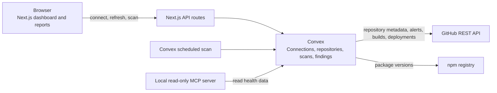

# Repo Monitor

Repo Monitor is a GitHub repository health dashboard built with Next.js 16 and Convex. Connect a GitHub personal access token (PAT), refresh the repositories it can access, and run scans from the dashboard.

## What it checks

- **Dependencies:** Reads `dependencies` and `devDependencies` from each repository's root `package.json`, then compares up to 50 packages with the npm registry. Findings classify available updates as patch, minor, or major. The package update policy can be set to any newer version, minor or major updates, or major updates only.
- **Repository practices:** Checks for a test script, GitHub Actions workflow, README and its freshness, and Dependabot configuration. A README is considered stale when its last commit was more than six months ago.
- **Security alerts:** Reports open GitHub Dependabot alerts when the token and repository expose them. If the data is unavailable, the finding is marked unknown.
- **Builds and deployments:** Shows the latest completed result GitHub exposes for the default branch, and active successful GitHub-integrated deployments. Indicators may be absent when GitHub has no data or the token cannot read it.
- **Repository reports:** Open a dedicated report for the latest findings, recommended follow-up links, and up to 20 recent scan history entries.

Scans can target one repository, selected repositories, or all repositories. You can filter results and open repository details from the dashboard. Weekly scheduled scans run through Convex cron jobs. If an API request fails, the scan preserves available results and reports partial or failed status.

## Getting started

### Requirements

- Node.js supported by the installed dependencies
- npm
- A Convex account and development deployment
- A GitHub PAT with access to the repositories you want to monitor

### Configure and run locally

Create `.env.local` in the project root and set the Convex deployment URL:

```bash
NEXT_PUBLIC_CONVEX_URL=https://<your-deployment>.convex.cloud
```

The Next.js API routes can use a Convex admin key when required by your deployment configuration:

```bash
CONVEX_ADMIN_KEY=<your-convex-admin-key>
```

GitHub tokens are encrypted (AES-256-GCM) before Convex stores them. Set an encryption key in the Convex deployment environment (not in `.env.local`) before connecting a PAT:

```bash
npx convex env set TOKEN_ENCRYPTION_KEY "$(openssl rand -base64 32)"
```

Keep a copy of this key. If it changes or is lost, stored tokens cannot be decrypted and you must reconnect your PAT. Tokens saved before encryption was added keep working and are encrypted the next time the connection is saved or refreshed.

Install packages and start the frontend and Convex development server:

```bash
npm install
npm run dev
```

Open [http://localhost:3000](http://localhost:3000), connect your PAT, and scan repositories. The in-app guide is available at `/manual`.

You can also choose **Explore sample data** on the home page to try the workflow with fictional repositories. Demo scans simulate results in the current browser session; they do not call GitHub, npm, or Convex. Demo state stays active while you move between the home, dashboard, and repository report pages in the same tab.

The GitHub token is submitted to the backend and stored by Convex. Keep `.env.local`, Convex admin keys, and PATs private; environment files are ignored by Git.

## System overview



The browser uses the Next.js app for the dashboard and repository reports. Convex stores connection and scan data and runs the scheduled work. During a scan, Convex actions read GitHub signals and compare package versions with npm. The local MCP server exposes read-only queries over the same Convex data. The sample demo is an in-browser simulation and bypasses those services.

## Screenshots

Add screenshots of the sample dashboard and a repository report here when image files are available. Use only fictional demo repositories in project screenshots; the connected dashboard can contain private repository names and scan data.

## Engineering decisions and tradeoffs

- **PAT connection first:** A GitHub PAT keeps the first-run setup direct and lets users control repository access. The tradeoff is a manual credential flow and permission-dependent signals; unavailable data is shown as unknown instead of failed.
- **Bounded dependency checks:** Scans inspect at most 50 root `package.json` dependencies and dev dependencies. This keeps external requests bounded, but does not cover every package in a large repository and does not resolve lockfile versions.
- **Convex for scan state:** Repositories, scan runs, and findings live together in Convex, while external API work runs in actions. This keeps the UI reactive and preserves scan history, with execution and request limits shaping how much work each scan does.
- **Session-only demo:** Fictional data and simulated scans make the product reviewable without credentials or backend writes. The tradeoff is that demo changes are temporary and do not represent real scan execution.
- **Single default connection:** The app currently targets a default connection rather than a multi-user workspace model. It is suitable for a personal project demo; user isolation and identity-aware access should come before a public multi-user launch.

## What I learned and what I would improve

Building this taught me to treat missing integration data as a distinct state: GitHub may omit alerts, checks, or deployment details because of permissions or repository settings, so the UI should not imply a failure. I also learned that a convincing demo needs a safe path through the same product workflow without depending on a real account.

Next, I would add identity-aware connection isolation before opening the app to multiple users, make scan retries and rate-limit outcomes clearer, and compare lockfile-resolved dependency versions rather than only declared ranges. The [focused roadmap](public/feature-improvements-roadmap.md) tracks those next steps.

## GitHub access

The PAT needs permission to read the repositories you want to monitor. Access to checks, commit statuses, deployments, and Dependabot alerts depends on the token's permissions and the repository's settings. When optional GitHub data is unavailable, Repo Monitor reports it as unknown or leaves its indicator blank rather than treating it as a failure.

## Commands

```bash
npm run dev        # Start the frontend and Convex development server
npm run dev:frontend # Start only the Next.js frontend
npm run dev:backend  # Start only the Convex development server
npm run mcp        # Start the local read-only MCP server over stdio
npm run build      # Create a production Next.js build
npm run start      # Serve the production build
npm run lint       # Run ESLint
npm run typecheck  # Run TypeScript without emitting files
npm test           # Run the Vitest suite once
npm run test:watch # Run Vitest in watch mode
```

## MCP server

The local read-only MCP server exposes four tools: `list_repositories`, `get_repository_health`, `list_attention_items`, and `get_connection_status`. It reads the default Repo Monitor connection from Convex and does not return credentials.

Set `NEXT_PUBLIC_CONVEX_URL` before starting it:

```bash
NEXT_PUBLIC_CONVEX_URL=https://<your-deployment>.convex.cloud npm run mcp
```

The connection key defaults to `default`; set `MCP_CONNECTION_KEY` to read a different connection. To inspect the server interactively, run `npx @modelcontextprotocol/inspector npm run mcp` with the same environment configured.

## Project layout

- `app/` contains the dashboard, manual, shared layout, and API routes.
- `components/` contains the dashboard and reusable UI components.
- `convex/` contains the database schema, GitHub integration and scans, scheduled jobs, and backend tests.
- `mcp/` contains the read-only MCP server and its Convex data source.
- `docs/` contains project learning notes and architecture decisions.

## Deployment

Deploy the Convex backend to the target environment and set `NEXT_PUBLIC_CONVEX_URL` for the Next.js host. Deploy the Next.js app to Vercel or another host that supports Next.js 16. Convex scheduled scans run when the deployed backend's cron job is active.

Build the frontend with:

```bash
npm run build
```
